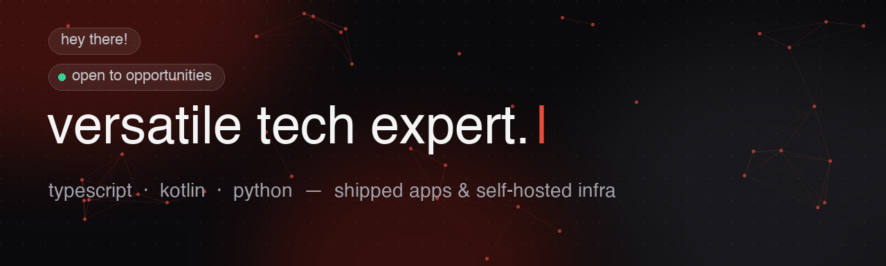
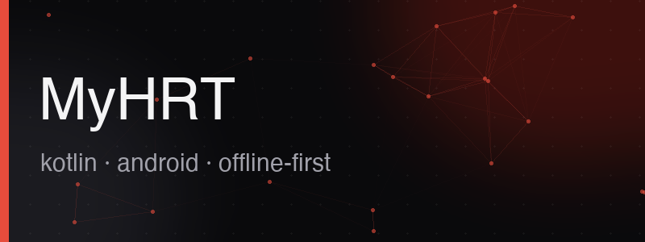
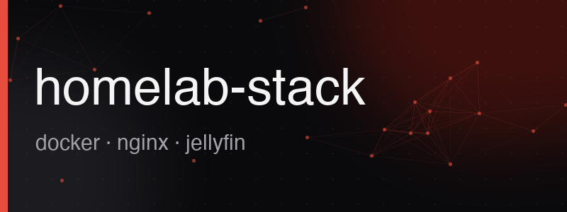
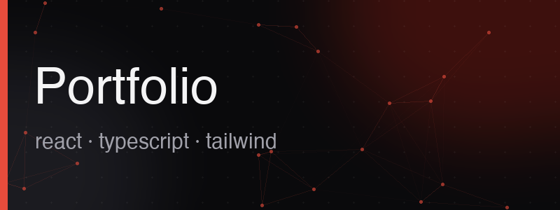

### hey, i'm aisling 👋

💻 software dev — i ship android apps, self-host the infra, and document the disasters

🟢 open to opportunities · 📂 [portfolio](https://aislingheart.github.io/Portfolio/) · ✉️ [email](mailto:aislingcreed42@gmail.com)

---

### projects

### how i work

- **ship real things** — MyHRT is a published v1.0 APK, this portfolio is live on GitHub Pages. demos over roadmaps.
- **debug the unglamorous bits** — my nginx subpath routing write-up covers proxy_pass slashes and sub_filter vs gzip, not the happy path.
- **reproducible > clever** — docker compose stacks, Homarr dashboard provisioned from diffable JSON. rebuildable beats impressive.

### toolbox

### stats

<!-- Colors match the portfolio: bg #0a0a0c, accent #e74c3c -->

 

### find me

<a href="https://aislingheart.github.io/Portfolio/">📂 portfolio</a> ·
<a href="mailto:aislingcreed42@gmail.com">✉️ email</a>

