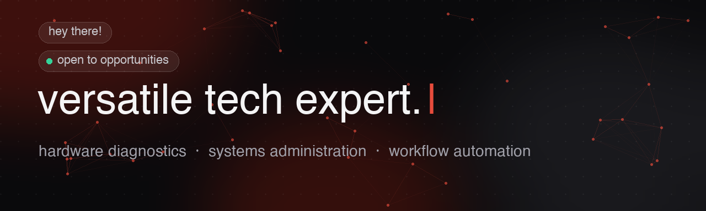

<!-- Banner: upload banner.png to your profile repo and keep this line. Or link to your Portfolio assets. -->

<!-- Typing headline, portfolio style -->

  <!-- pills like your site -->
  
  
   

  
<i>hey, i'm Aisling! 👋 i work across <b>hardware diagnostics</b>, <b>systems administration</b>, and <b>workflow automation</b>. whether that's micro-soldering delicate flex cables, managing homelab servers, or swapping a Linux drive to save a live exam — i love solving real technical problems with practical solutions.</i>

  
<i>currently building out my skills in <code>sysadmin</code>, <code>networking</code>, and <code>scripting</code>.</i>

  
  
  

---

### 🧰 what i do

<table>
<tr>
<td width="33%" valign="top">

**hardware diagnostics 🔧**
  
component repairs, panic log diagnostics, and micro-soldering. bringing broken or “unfixable” gear back to life.
  
<a href="https://aislingheart.github.io/Portfolio/#/hardware">explore →</a>

</td>
<td width="33%" valign="top">

**support & admin 🛡️**
  
crisis triage, homelab server management, and practical tech support that puts people first.
  
<a href="https://aislingheart.github.io/Portfolio/#/support-admin">explore →</a>

</td>
<td width="33%" valign="top">

**workflow automation ⚡**
  
custom scripts, environment shortcuts, and automated workflows to skip repetitive manual tasks.
  
<a href="https://aislingheart.github.io/Portfolio/#/automation">explore →</a>

</td>
</tr>
</table>

### 💡 how i work

- **quality control** — rigorous bench testing before *and* after repairs so devices stay reliable long term.
- **clear communication 💛** — explaining complex diagnostics with simple analogies (like “the bucket” for battery health).
- **problem-solving mindset** — adaptable troubleshooting steps to handle unexpected failures under pressure.

### 🛠️ toolbox

### 📊 stats

<!-- Replace `aislingheart` with your username if different. Colors match your site: bg #0a0a0c, accent #e74c3c -->

 

### 📫 find me

<a href="https://aislingheart.github.io/Portfolio/">📂 Portfolio</a> ·
<a href="mailto:aislingcreed42@gmail.com">✉️ aislingcreed42@gmail.com</a>

  

© 2026 aisling. built with 💛 and way too many energy drinks. 
terminal-first · hardware-focused ✨ · cat-approved 🐱

